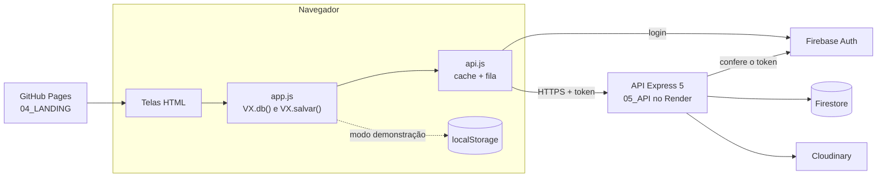

# VEXOcar

  
**O prontuário digital do seu carro.** Histórico de manutenção comprovado por nota fiscal, alertas de revisão, óleo,
IPVA e licenciamento, painel de gastos, oficinas próximas com avaliações e uma vitrine onde o carro é vendido junto com
o histórico (e transferido para a conta do comprador).

[](https://mmarcatoricardo.github.io/vexocar/app/demo.html)
[](https://mmarcatoricardo.github.io/vexocar/)
[](LICENSE)


Projeto Integrador de **Design Profissional** (Prof. Sedenilso Machado), Universidade Positivo, 2026.
Segmento: **4. Hub Digital de Manutenção e Histórico Veicular**.

| | |
|---|---|
| Site e app | https://mmarcatoricardo.github.io/vexocar/ |
| App direto | https://mmarcatoricardo.github.io/vexocar/app/entrar.html |
| Demonstração (sem criar conta, 3 carros de exemplo) | https://mmarcatoricardo.github.io/vexocar/app/demo.html |
| API | https://vexocar.onrender.com/api/saude |

QR code do site: [`02_MARCA/qrcode-site.png`](02_MARCA/qrcode-site.png) (simples) e [`02_MARCA/qrcode-site-marca.png`](02_MARCA/qrcode-site-marca.png) (com a marca).
No celular, o site pode ser instalado como app: botão **Instalar app** na página inicial ou no Perfil.

E se você errar o endereço, a [página 404](https://mmarcatoricardo.github.io/vexocar/qualquer-coisa) vira um joguinho: desvie dos cones trocando de faixa com as setas.

> A API roda no plano grátis do Render, que "dorme" depois de 15 minutos parado. O primeiro acesso pode levar
> cerca de 1 minuto para acordar.

## Equipe

| Integrante | Curso | Função |
|---|---|---|
| Ricardo Medeiros Marcato | Engenharia de Software | Tech Lead e Marca: arquitetura, banco, deploy e integração |
| Daniel Ribeiro da Costa | Engenharia de Software | UX/UI e Protótipo: telas e front-end |
| Lucas Markovicz Costa | Sistemas de Informação | Pesquisa e Produto (PO): API e relatório |

## O que tem no repositório

| Pasta | O quê |
|---|---|
| `01_PESQUISA/` | Script do Google Forms da pesquisa com o público (motoristas de app e donos de carro) |
| `02_MARCA/` | Logo "V de pista", ícone, guia da marca (Audiowide + Inter, grafite + verde-pista) |
| `03_WIREFRAMES/` | Gerador dos wireframes e plugin do Figma que liga o protótipo |
| `04_LANDING/` | **O front-end:** landing page (`index.html`) e o app com 19 telas e a porta da demonstração (`app/`) |
| `05_API/` | **O back-end:** API REST em Node.js + Express ([README próprio](05_API/README.md)) |
| `06_ALTA_FIDELIDADE/` | Gerador das telas de alta fidelidade enviadas ao Figma |
| `docs/` | **Documentação técnica** (veja abaixo) |

## Tecnologias

- **Front-end:** HTML, CSS e JavaScript puros, Leaflet (mapa das oficinas), publicado no GitHub Pages.
- **Back-end:** Node.js 20+, Express 5, publicado no Render.
- **Banco e login:** Firebase (Firestore + Authentication com e-mail/senha e Google).
- **Fotos:** Cloudinary (carros, notas fiscais, anúncios).
- **Design:** Figma (marca, wireframes e alta fidelidade).

## Arquitetura

O front-end é HTML, CSS e JavaScript puros, sem framework, publicado no GitHub Pages. O back-end é uma API REST em
Node.js + Express 5, no Render, que guarda os dados no Firestore, confere o login do Firebase Auth e manda as fotos
para o Cloudinary. As telas só chamam `VX.db()` e `VX.salvar(d)`; o arquivo `app/js/api.js` descobre o que mudou e
manda para a API por uma fila guardada no navegador. Sem servidor (`file://`) ou com `?modo=demo`, o app roda em
modo demonstração, com os dados no próprio navegador.



Detalhes em [docs/ARQUITETURA.md](docs/ARQUITETURA.md).

## Documentação

| Documento | O que tem |
|---|---|
| [Índice da documentação](docs/README.md) | Lista de todos os documentos |
| [Visão geral](docs/VISAO-GERAL.md) | Problema, público, proposta de valor, escopo por nível e o que ficou fora |
| [Funcionalidades](docs/FUNCIONALIDADES.md) | Cada tela e as regras: alertas, nota de saúde, gastos, vitrine, FIPE, transferência, avaliações |
| [Arquitetura](docs/ARQUITETURA.md) | Front ↔ API ↔ Firebase/Cloudinary, modos, pastas e segurança |
| [API](docs/API.md) | Todas as rotas, com corpo e resposta |
| [Modelo de dados](docs/MODELO-DE-DADOS.md) | Coleções, campos e diagrama |
| [Guia de execução](docs/GUIA-DE-EXECUCAO.md) | Rodar no computador e resolver problemas comuns |
| [Deploy](docs/DEPLOY.md) | GitHub Pages, Render, Firebase e como publicar mudanças |
| [Design](docs/DESIGN.md) | Marca, princípios, wireframes, alta fidelidade e acessibilidade |
| [Pesquisa](docs/PESQUISA.md) | Como funciona a pesquisa e a lista de perguntas |

## Rodar no computador

```bash
cd 05_API
npm install
npm start
```

Abra http://localhost:3000 (site) ou http://localhost:3000/app/entrar.html (app).
Sem o arquivo `.env`, tudo roda em **modo local** (banco em arquivo, login próprio, fotos em pasta), sem precisar de
nenhuma conta. Para usar Firebase e Cloudinary, copie `05_API/.env.exemplo` para `05_API/.env` e preencha.

Também dá para abrir `04_LANDING/index.html` direto no navegador: o app entra em **modo demonstração**, com dados
de exemplo guardados no próprio navegador.

Passo a passo completo e solução de problemas: [docs/GUIA-DE-EXECUCAO.md](docs/GUIA-DE-EXECUCAO.md).

## Licença

MIT. Fotos da landing: Unsplash (ver `04_LANDING/CREDITOS.md`).
