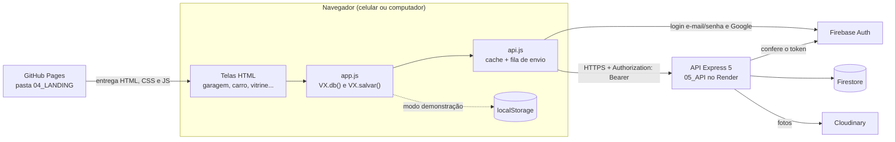

# Arquitetura

## Visão de cima

O VEXOcar tem duas partes:

- **Front-end** (`04_LANDING/`): landing page e app em **HTML, CSS e JavaScript puros**, sem framework e sem
  etapa de build. Publicado no **GitHub Pages**.
- **Back-end** (`05_API/`): API REST em **Node.js + Express 5**, publicada no **Render**. A API também serve os
  arquivos do site (útil para rodar tudo no computador com um comando só).

Serviços externos:

| Serviço | Para quê | Quem usa |
|---|---|---|
| **Firestore** (Firebase) | Banco de dados | só a API, com a chave de serviço |
| **Firebase Authentication** | Login com e-mail/senha e Google | o navegador faz o login; a API confere o token |
| **Cloudinary** | Fotos (carros, notas fiscais, anúncios) | só a API |
| **Leaflet + mapa da Esri** (World Dark Gray) | Mapa das oficinas | o navegador |
| **qrcodejs** | QR code do histórico em PDF | o navegador |



## Como as telas continuam iguais: `VX.db()`, `VX.salvar()` e a fila

As telas foram feitas primeiro só com dados no navegador. Para ligar a API **sem reescrever as telas**, toda tela
carrega três scripts, nesta ordem:

1. `js/dados.js`: os dados de exemplo (`window.VX_DADOS`).
2. `js/api.js`: decide o modo e, no modo API, cria `window.VXAPI`.
3. `js/app.js`: as funções comuns (`window.VX`).

Cada tela só faz isto:

```js
var d = VX.db();        // lê tudo
d.carros.push(novo);    // muda o objeto
VX.salvar(d);           // salva
```

O que acontece por baixo:

| Função | Modo demonstração | Modo API |
|---|---|---|
| `VX.db()` | lê de `localStorage` (chave `vexocar:v1`); se a versão dos dados de exemplo mudou, recarrega o exemplo | devolve a **cópia local (cache)** do que veio da API |
| `VX.salvar(d)` | grava em `localStorage` | compara `d` com a última versão enviada, descobre o que mudou e põe os pedidos numa **fila** |

**A fila** (`api.js`):

- Para cada coleção da pessoa (`carros`, `transferidos`, `manutencoes`, `pagamentos`, `meusAnuncios`, `avaliacoes`),
  o que é novo ou mudou vira um `PUT /api/<coleção>/<id>`, e o que sumiu vira um `DELETE`.
  Mudanças no perfil (`usuario`, `notificacoes`, `favoritos`, `vistos`) viram um único `PATCH /api/usuario`.
- A fila fica guardada no navegador e é enviada **um pedido por vez**. Se o mesmo registro já está esperando,
  ele é trocado pela versão mais nova.
- **Fotos:** antes de mandar um registro, as fotos em base64 sobem para `POST /api/fotos`; o base64 é trocado
  pelo endereço da foto. O app lembra das fotos que já subiram para não mandar duas vezes.
- **Sem internet ou servidor dormindo:** o pedido fica na fila e o app tenta de novo a cada 8 segundos e quando a
  internet volta. Se a pessoa trocar de tela, a fila continua na próxima.
- **API recusou (erro 4xx):** o pedido sai da fila e aparece um aviso "Não deu para salvar: ...".
- **Sessão expirou (401):** limpa a sessão e volta para o login.
- Ao abrir cada tela, o app manda o que estava na fila e busca `GET /api/estado`. Se o servidor tiver algo mais
  novo (outro aparelho), atualiza o cache e recarrega a tela uma vez. Formulários abertos não recarregam, para não
  perder o que foi digitado.

Ações que não cabem na comparação (transferir o carro, contar visita, restaurar exemplo) chamam a API direto,
por funções de `VXAPI`.

## Os modos

### Modos do front-end

| Como abre | Modo | Onde ficam os dados |
|---|---|---|
| Arquivo direto do computador (`file://`) | **Demonstração** | `localStorage` do navegador |
| Qualquer endereço com `?modo=demo`, ou `app/demo.html` | **Demonstração** | `localStorage` do navegador |
| Pelo servidor (`http://localhost:3000` ou o site publicado) | **API** | banco, com login de verdade |
| `?modo=api` | volta para o modo API | |

O modo escolhido pela URL fica guardado no navegador. Na demonstração aberta pelo site aparece um **selo**
"Modo demonstração" com duas saídas: **Criar minha conta** (volta ao modo API) e **Voltar ao início**
(a landing desliga a demonstração).

Na demonstração, a data de "hoje" é fixa em **03/11/2026**, para a apresentação sair sempre igual.
No modo API, "hoje" é a data real.

**Qual API o front chama:** aberto em `localhost`, `127.0.0.1` ou numa rede `192.168.*`, o front chama o próprio
endereço (`location.origin`). Em qualquer outro endereço (GitHub Pages), chama a API publicada no Render.

### Modos da API

A API escolhe sozinha, ao ligar, o modo de cada parte (`05_API/src/config.js`). O terminal mostra o resultado,
por exemplo `Banco: local · Login: local · Fotos: local`.

| Parte | Modo local (sem `.env`) | Modo nuvem | Quando liga o modo nuvem |
|---|---|---|---|
| **Banco** | arquivo `dados-locais.json` | **Firestore** | existe a chave de serviço do Firebase (`FIREBASE_SERVICE_ACCOUNT` ou o arquivo `serviceAccountKey.json`) |
| **Login** | contas criadas pela própria API (senha com scrypt, token assinado com HMAC) | **Firebase Auth** (e-mail/senha e Google) | chave de serviço **e** `FIREBASE_API_KEY` |
| **Fotos** | pasta `uploads/`, servida em `/uploads/...` | **Cloudinary** | `CLOUDINARY_URL` (ou as três variáveis separadas) |

O banco tem uma "interface" de **6 funções** (`src/banco/index.js`): `listarDoUsuario`, `listarTodos`, `obter`,
`gravar`, `apagar` e `gravarVarios`. `firestore.js` e `local.js` implementam as mesmas 6. As rotas só conhecem
essas funções, então o mesmo código roda no computador e no Render.

**Dados de exemplo no banco:** ao ligar, a API lê o mesmo `04_LANDING/app/js/dados.js` do site e grava oficinas,
anúncios de exemplo e avaliações de exemplo, **uma vez por versão** (campo `versao` de `dados.js`, guardado no
documento `sistema/exemplo`). Os carros de exemplo só entram na conta de quem pede ("Restaurar dados de exemplo").

## Estrutura de pastas

```
.
├── .github/workflows/pages.yml   publica 04_LANDING no GitHub Pages
├── 01_PESQUISA/                  script do Google Forms da pesquisa
├── 02_MARCA/                     logo, ícones, guia da marca e o gerador do guia
├── 03_WIREFRAMES/                gerador dos wireframes e do fluxo + plugin do Figma
├── 04_LANDING/                   FRONT-END (vai inteiro para o GitHub Pages)
│   ├── index.html                landing page
│   ├── 404.html                  página não encontrada
│   ├── manifest.webmanifest      app instalável (PWA)
│   ├── sw.js                     service worker (sem cache offline)
│   ├── css/estilo.css            estilo da landing
│   ├── js/landing.js             animações da landing e botão Instalar app
│   ├── img/                      fotos, ícones do app, equipe
│   └── app/                      as telas do app (*.html)
│       ├── css/app.css           estilo do app
│       └── js/
│           ├── dados.js          dados de exemplo (também lidos pela API)
│           ├── api.js            ligação com a API: modos, login, cache e fila
│           ├── app.js            funções comuns: alertas, nota, formatação, menu, ícones, PWA
│           └── vitrine.js        anúncios, FIPE de exemplo, categoria
├── 05_API/                       BACK-END
│   ├── package.json
│   ├── .env.exemplo              nomes das variáveis (o .env de verdade não vai para o Git)
│   └── src/
│       ├── servidor.js           liga tudo: CORS, JSON, rotas, site, erros
│       ├── config.js             lê o .env e escolhe os modos
│       ├── auth.js               confere o token (Firebase ou local) e cuida das contas locais
│       ├── firebase.js           conexão única com o Firebase Admin
│       ├── fotos.js              Cloudinary ou pasta uploads/
│       ├── vitrine.js            anúncios entre usuários e transferência do prontuário
│       ├── exemplo.js            dados de exemplo (lê ../04_LANDING/app/js/dados.js)
│       ├── banco/                index.js escolhe firestore.js ou local.js
│       └── rotas/                publico.js, conta.js, colecoes.js
├── 06_ALTA_FIDELIDADE/           gerador das telas de alta fidelidade para o Figma
└── docs/                         esta documentação
```

## Login, passo a passo

**Modo Firebase:**

1. O navegador pede `GET /api/config` e recebe o modo de login e a configuração pública do Firebase
   (a `apiKey` web do Firebase não é segredo; ela vai para o navegador de qualquer jeito).
2. E-mail e senha: o navegador fala direto com o Firebase Auth (cadastro, login e "esqueci a senha").
   Google: o SDK do Firebase é baixado só quando a pessoa clica, e abre a janela do Google.
3. O navegador guarda o token (vale 1 hora) e o renova sozinho com o refresh token.
4. Toda chamada à API leva `Authorization: Bearer <token>`. A API confere com o `firebase-admin`.

**Modo local:**

1. `POST /api/auth/criar-conta` ou `POST /api/auth/entrar`.
2. A API devolve um token próprio, válido por **30 dias**.
3. O resto é igual: `Authorization: Bearer <token>`.

Depois do login, `GET /api/estado` traz tudo o que o app precisa de uma vez.

## Escolhas de segurança

| Escolha | Como está feito |
|---|---|
| **Login por token, não por cookie** | Toda rota privada passa pelo `exigirLogin` (`auth.js`), que lê o cabeçalho `Authorization: Bearer`. Sem token válido: `401`. |
| **Token do modo local** | `base64(dados).assinatura`, com assinatura **HMAC SHA-256** e comparação em tempo constante (`timingSafeEqual`). Expira em 30 dias. O segredo vem de `SEGREDO_LOCAL`; o valor padrão do código é só para testes. |
| **Senha do modo local** | Guardada com **scrypt** e um sal aleatório de 16 bytes por conta. Nunca em texto. Mínimo de 8 caracteres. |
| **Cada um só mexe no que é seu** | Todo documento leva o `uid` do dono. A API filtra por `uid` ao ler e recusa (`403`) alterar ou apagar registro de outra conta. Manutenção, pagamento e anúncio só entram em carro da própria garagem. |
| **Validação no servidor** | Cada coleção tem regras (placa, ano, km, datas, valores, tipo de serviço, nota de 1 a 5). O id precisa ter de 1 a 80 letras, números, `_` ou `-`. |
| **Fotos** | Só JPG, PNG ou WEBP, até 3 MB, enviadas por `/api/fotos`. Um registro com foto em base64 grande é recusado. O corpo JSON tem limite de 5 MB. |
| **CORS** | O navegador só pode chamar a API a partir dos sites de `ORIGENS_PERMITIDAS` (separados por vírgula) e de qualquer `localhost`. Sem a lista, libera todos, já que o login é por token. |
| **Segredos fora do Git** | `.env`, `serviceAccountKey.json`, chaves do Firebase Admin, `dados-locais.json` e `uploads/` estão no `.gitignore`. No Render, os valores ficam nas variáveis de ambiente do painel. Só o `.env.exemplo` (sem valores) vai para o repositório. |
| **Firestore fechado** | O banco é criado em modo de produção: ninguém acessa direto pelo navegador; só a API, com a chave de serviço. |
| **Página pública mascarada** | `GET /api/publico/carros/:id` devolve o histórico **sem valores em R$**, com a **placa mascarada** (`BRA2E19` vira `BRA***9`; o final continua visível) e **sem a foto da nota fiscal**. |
| **Vitrine entre usuários** | Os anúncios de outras pessoas vêm com a placa mascarada, sem foto da nota, e com valores só se o dono marcou "mostrar valores". |
| **Erros sem detalhes** | Erros 500 mostram só "Erro no servidor. Tente de novo."; o detalhe fica no terminal. O cabeçalho `x-powered-by` é desligado. |
| **HTML escapado** | As telas passam texto digitado pela função `VX.esc` antes de montar HTML. |
| **Redirecionamento seguro** | O `?ir=` do login só aceita nomes de telas do próprio app. |
| **WhatsApp de exemplo** | Os contatos de exemplo usam o valor `contatoDemo` de `dados.js`, que fica vazio no repositório. Nunca se usa número inventado, porque pode ser de alguém real. |
| **"Esqueci a senha"** | Não conta se o e-mail tem conta ou não. |
