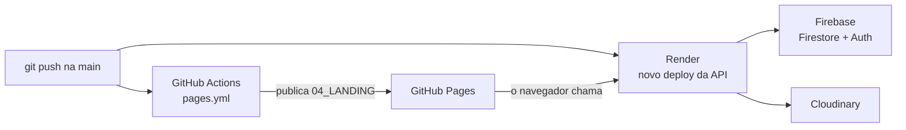

# Deploy

O VEXOcar fica publicado em dois lugares:

| O quê | Onde | Endereço |
|---|---|---|
| Site e app (front-end) | **GitHub Pages** | https://mmarcatoricardo.github.io/vexocar/ |
| Demonstração | GitHub Pages | https://mmarcatoricardo.github.io/vexocar/app/demo.html |
| API (back-end) | **Render** | https://vexocar.onrender.com/api/saude |



## GitHub Pages (front-end)

O workflow `.github/workflows/pages.yml` publica a pasta **`04_LANDING`** inteira.

| Item | Valor |
|---|---|
| Quando roda | a cada `push` na `main` que mexe em `04_LANDING/**` ou no próprio `pages.yml`; também dá para rodar à mão (aba Actions > "Publicar site" > Run workflow) |
| Passos | `actions/checkout` > `actions/configure-pages` > `actions/upload-pages-artifact` (pasta `04_LANDING`) > `actions/deploy-pages` |
| Permissões | `contents: read`, `pages: write`, `id-token: write` |
| Concorrência | grupo `pages`; um deploy novo cancela o que estava rodando |

No repositório, em Settings > Pages, a fonte tem que ser **GitHub Actions**.

O GitHub Pages abre as páginas sem `.html` (ex.: `/vexocar/app/garagem`) e mostra o `404.html` para endereços
que não existem.

**Qual API o site chama:** o endereço da API publicada está em `04_LANDING/app/js/api.js`
(`API_PUBLICADA = 'https://vexocar.onrender.com'`). Se a API mudar de endereço, troque ali e suba o `?v=`.

## Render (API)

A API roda como **Web Service** no Render, ligado ao repositório do GitHub.

| Configuração | Valor |
|---|---|
| Tipo | Web Service (Node) |
| Build Command | `cd 05_API && npm install` |
| Start Command | `cd 05_API && npm start` |
| Versão do Node | 20.12 ou mais nova (`engines` do `package.json`) |
| Plano | grátis: **dorme depois de 15 minutos sem uso**; o primeiro acesso pode levar cerca de 1 minuto |

A porta não precisa ser configurada: o Render define `PORT` e a API usa essa variável.
A API já está preparada para ficar atrás do proxy https do Render (`trust proxy`).

### Variáveis de ambiente no Render

Cadastre no painel do Render (Environment). **Só os nomes estão aqui; os valores nunca vão para o Git.**

| Variável | Obrigatória? | O que é |
|---|---|---|
| `FIREBASE_SERVICE_ACCOUNT` | sim, para usar Firestore | o JSON inteiro da chave de serviço do Firebase, numa linha |
| `FIREBASE_API_KEY` | sim, para o login pelo Firebase | `apiKey` do app web do Firebase |
| `FIREBASE_AUTH_DOMAIN` | não | se faltar, usa `<projeto>.firebaseapp.com` |
| `FIREBASE_PROJECT_ID` | não | se faltar, sai da chave de serviço |
| `CLOUDINARY_URL` | sim, para fotos no Cloudinary | `cloudinary://...` do painel do Cloudinary |
| `ORIGENS_PERMITIDAS` | recomendada | sites que podem chamar a API, ex.: `https://mmarcatoricardo.github.io` |

Sem `FIREBASE_SERVICE_ACCOUNT`, a API do Render cairia no modo local (banco em arquivo), e o disco do plano grátis
não guarda arquivos entre deploys. Confira o modo em `/api/saude`: precisa mostrar `"banco": "firestore"`,
`"login": "firebase"` e `"fotos": "cloudinary"`.

### Antes de uma apresentação

Abra https://vexocar.onrender.com/api/saude uns minutos antes, para a API acordar.
Se algo der errado, a demonstração (https://mmarcatoricardo.github.io/vexocar/app/demo.html) funciona sem a API.

## Firebase: domínios autorizados

O login com Google só abre em endereços liberados no Firebase:
**Authentication > Settings > Authorized domains**.

| Domínio | Para quê |
|---|---|
| `localhost` | rodar no computador |
| `mmarcatoricardo.github.io` | o site publicado |
| `vexocar.onrender.com` | só se for usar o app aberto direto pelo endereço do Render |

Se o domínio não estiver na lista, o app mostra: "Este endereço não está liberado no Firebase
(Authentication > Settings > Authorized domains)."

## Como publicar uma mudança

1. Faça a mudança e teste no computador (`cd 05_API && npm start`, veja [GUIA-DE-EXECUCAO.md](GUIA-DE-EXECUCAO.md)).
2. Mexeu em **JS ou CSS** do front? Suba o `?v=` (abaixo).
3. Mexeu nos **dados de exemplo** (`dados.js`)? Suba o número `versao` dentro do arquivo.
4. Faça o commit e o push na `main`:

   ```bash
   git add .
   git commit -m "descreva a mudança"
   git push
   ```

5. **GitHub Pages:** o workflow roda sozinho (se a mudança tocou em `04_LANDING`). Acompanhe na aba Actions.
6. **Render:** faz um novo deploy da API a partir do push. Acompanhe no painel do Render.
7. Confira o site publicado e o `/api/saude`.

## Versão dos arquivos (`?v=`)

Toda tela carrega CSS e JS com um número de versão no fim, por exemplo:

```html
<link rel="stylesheet" href="css/app.css?v=20261104b">
<script src="js/app.js?v=20261104b"></script>
```

O navegador guarda esses arquivos em cache. Se você mudar `app.js` e não mudar o `?v=`, quem já abriu o site pode
continuar vendo a versão antiga. Por isso:

- **Sempre que mudar um `.js` ou `.css` do front, troque o `?v=` em todas as telas.** O padrão usado é a data
  (`AAAAMMDD`) + uma letra (`a`, `b`, `c`...) para mais de uma publicação no mesmo dia.
- Troque em todos os arquivos de uma vez (busca e troca no editor). No Git Bash, por exemplo:

  ```bash
  grep -rl "v=20261104b" 04_LANDING | xargs sed -i "s/v=20261104b/v=20261105a/g"
  ```

- Confira que não sobrou nenhum: `grep -rn "v=20261104b" 04_LANDING` não pode mostrar nada.

## O que nunca publicar

`.env`, `.env.*` (menos `.env.exemplo`), `serviceAccountKey.json`, chaves `*-firebase-adminsdk-*.json`,
`05_API/firebase-config-web.txt`, `dados-locais.json` e `uploads/`. Todos estão no `.gitignore`. Antes de um
commit, confira com `git status` que nenhum deles aparece.
