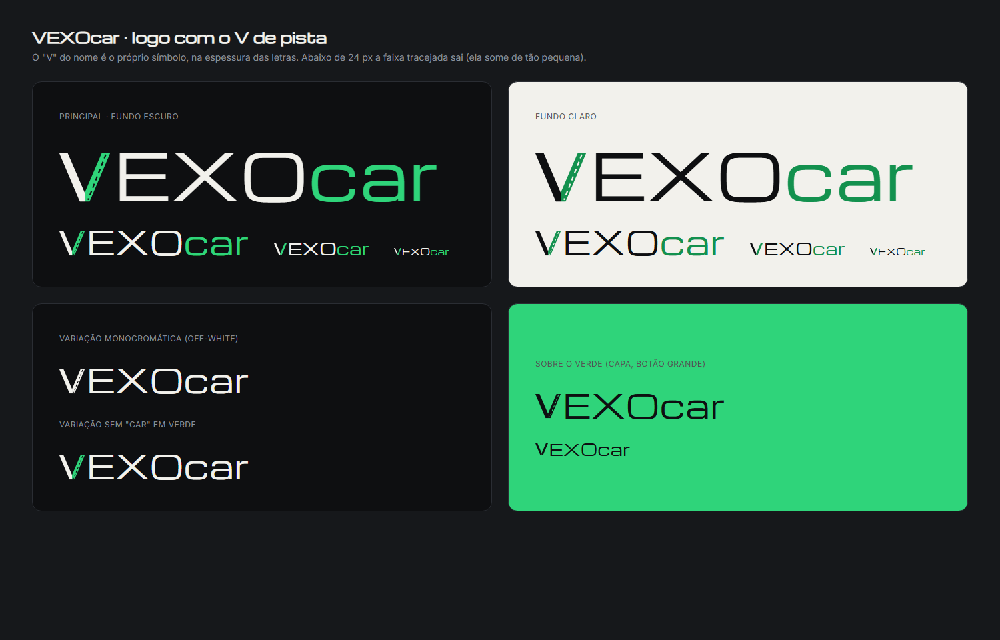
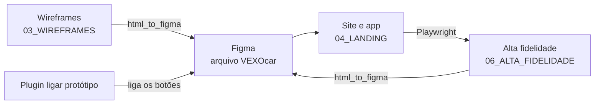

# Design

## Marca

O guia completo está em [`02_MARCA/marca_guia.html`](../02_MARCA/marca_guia.html) (imagem:
[`marca_guia.png`](../02_MARCA/marca_guia.png)). Ele é gerado pelo script `02_MARCA/gerar_guia.py`, que também
gera os SVGs do símbolo.

### Logo: o "V de pista"

O "V" de VEXO é uma estrada: a perna esquerda é o carro, a direita é a **pista verde com a faixa tracejada**.
Ele é o próprio V do nome, nunca um ícone colado ao lado. O nome se escreve **VEXOcar**: VEXO em maiúsculas,
car em minúsculas.

| Regra | Valor |
|---|---|
| Versões | principal (fundo escuro), fundo claro, monocromática e sobre o verde |
| Tamanhos | 72 px (títulos, capa), 40 px (cabeçalho do site), 24 px (menu do app, sem a faixa), 16 px (mínimo) |
| Faixa tracejada | sai abaixo de 24 px de altura de letra (vira borrão) |
| Respiro | igual à altura do "E" em volta do logo |
| Ícone | só o V, onde o nome não cabe: ícone do app, aba do navegador, avatar |
| Não fazer | esticar, inclinar, girar ou trocar as cores do V (a perna verde é sempre a da direita) |

Arquivos em `02_MARCA/`:

| Arquivo | O quê |
|---|---|
| `logo_vexocar.html` / `.png` | logo |
| `vexocar-v.svg`, `vexocar-v-claro.svg` | símbolo V (fundo escuro e claro) |
| `vexocar-icone-app.svg` | ícone do app |
| `opcoes_logo.html` / `.png` | opções de logo estudadas |
| `opcoes_fonte.html` / `.png` | opções de fonte estudadas |
| `qrcode-site.png`, `qrcode-site-marca.png` | QR code do site (simples e com a marca) |

### Cores

Fundo escuro na maior parte, texto claro, e o verde só onde importa: ação principal e dado positivo.
O âmbar aparece apenas em alerta. Vermelho só em erro.

| Cor | Hex | Proporção | Uso |
|---|---|---|---|
| Grafite | `#0E0F11` | 70% | fundo principal do site e do app |
| Off-white | `#F2F1EC` | 20% | texto, perna esquerda do V, fundo claro |
| Verde-pista | `#2FD47A` | 8% | botão principal, links, dado positivo, perna direita do V |
| Âmbar | `#F5A524` | 2% | somente alertas: revisão, IPVA, licenciamento |
| Grafite 2 | `#1A1C20` | — | cartões e superfícies acima do fundo |
| Linha | `#2A2D33` | — | bordas e divisórias |
| Cinza | `#8A8F98` | — | texto secundário, legendas |
| Verde escuro | `#13914E` | — | verde sobre fundo claro (contraste) |
| Vermelho (erro) | `#E5484D` | — | só erro e alerta vencido (usado no app) |

As mesmas cores são variáveis CSS (`--grafite`, `--off`, `--verde`, `--ambar`...) em `04_LANDING/css/estilo.css`
e `04_LANDING/app/css/app.css`.

### Tipografia

**Audiowide para gritar, Inter para conversar.** As duas vêm do Google Fonts.

| Estilo | Fonte | Tamanho | Uso |
|---|---|---|---|
| Display | Audiowide Regular | 56 px | landing, capa |
| Título 1 | Audiowide Regular | 36 px | título de página |
| Título 2 | Audiowide Regular | 24 px | seção |
| Título 3 | Inter SemiBold | 20 px | cartão, item |
| Corpo | Inter Regular | 16 px | texto corrido |
| Número | Inter SemiBold | 32 px | km, valores, datas |
| Legenda | Inter Medium | 13 px | rótulos, metadados |

Audiowide só no logo, em títulos grandes e chamadas. **Nunca** em parágrafos, botões ou números.

## Princípios

| Onde | Princípio | Como aparece |
|---|---|---|
| **Landing** | **Cinematográfica** | Foto grande em tela cheia, paralaxe leve, seções que aparecem ao rolar, velocímetros que enchem, contador animado. Referências: Aston Martin e Porsche (nota do wireframe da landing). |
| **Sistema (app)** | **Limpo e denso** | Interface escura, foto só quando ela é conteúdo (o carro). Animações curtas, de 150 a 250 ms. Celular: barra de navegação embaixo. Computador: menu lateral. |
| **Confiança** | Verde = comprovado | Serviço com nota fiscal ganha a cor verde e o selo "Histórico VEXOcar". |
| **Uma ação por vez** | Caminho óbvio | Garagem vazia tem um único botão: "Adicionar meu primeiro carro". |

## Do wireframe ao site

1. **Wireframes (baixa fidelidade)**: `03_WIREFRAMES/gerar_wireframes.py` gera
   - `wireframes.html`: as **22 telas** em cinza, cada uma com número, nível (Site, MVP, Nível 2, Nível 3, Extra) e
     uma nota explicando a tela;
   - `wireframes_extra.html`: só as telas de fluxo (15 a 22);
   - `fluxo.html`: o **fluxo do usuário** com os 6 caminhos principais (chegar e criar conta, já tenho conta,
     cuidar do carro, vender o carro, comprar um carro, oficina verifica).

   Cada tela é um `
`, que vira um frame próprio ao importar no Figma.
   Rodar: `python gerar_wireframes.py` dentro de `03_WIREFRAMES`.
2. **Protótipo no Figma**: o plugin `03_WIREFRAMES/plugin_ligar_prototipo/` ("VEXOcar - ligar protótipo") liga os
   botões das 22 telas no modo protótipo e cria os pontos de partida dos fluxos. Roda no Figma desktop, no arquivo
   **"VEXOcar"** (Plugins > Development). Pode rodar de novo: ele só substitui as mesmas ligações.
3. **Site e app**: as telas viraram HTML, CSS e JS em `04_LANDING`, com a marca aplicada.
   As telas 13 e 20 dos wireframes (oficina usando o app) ficaram fora; veja [VISAO-GERAL.md](VISAO-GERAL.md#o-que-ficou-fora-e-por-quê).
4. **Alta fidelidade**: `06_ALTA_FIDELIDADE/gerar_alta_fidelidade.py` abre cada tela do site pronto com o
   Playwright (modo demonstração, "hoje" = 03/11/2026), congela o HTML e o CSS com `capturar.js` e junta tudo em
   `celular.html` (390 px, 20 telas do app) e `computador.html` (1440 px, 11 telas, incluindo a landing e a 404). Cada `<section class="tela">` vira um frame no
   Figma. Precisa da API ligada (`cd 05_API && npm start`), porque as páginas são servidas por ela.
   Os dois HTML gerados não vão para o Git (são grandes e refeitos pelo script).

O `capturar.js` resolve as media queries para a largura da tela, troca `vh`/`vw` por pixels, transforma imagens em
data URI e põe escopo `#ID` no CSS, para várias telas conviverem no mesmo documento.

## Acessibilidade

O que dá para conferir no código:

| Cuidado | Onde |
|---|---|
| **Contraste alto** | Off-white sobre grafite: cerca de **17:1**. Verde-pista sobre grafite: cerca de **9,9:1**. Cinza (texto secundário) sobre grafite: cerca de **5,9:1**; sobre os cartões (`#1A1C20`): cerca de **5,3:1**. Âmbar sobre grafite: cerca de **9,4:1**. Todos passam do mínimo de 4,5:1 para texto normal. O verde escuro `#13914E` sobre off-white fica em cerca de 3,6:1, por isso ele aparece em logo e elementos grandes sobre fundo claro (como o PDF). |
| **Menos movimento** | `@media (prefers-reduced-motion: reduce)` nos dois CSS reduz animações e transições a quase zero. Na landing, `landing.js` também desliga a paralaxe e mostra o número do contador direto. |
| **Foco visível** | `:focus-visible` com contorno verde de 2 px nos dois CSS. |
| **Teclado** | Janelas fecham com Esc e o foco vai para o botão principal. Itens da lista de oficinas abrem com Enter ou espaço. As estrelas da avaliação mudam com as setas. |
| **Leitores de tela** | Velocímetro com `role="img"` e `aria-label="Nota de saúde N de 100"`; chips e filtros com `aria-pressed`; avisos com `role="status"`; janelas com `role="dialog"` e `aria-modal`; botões só com ícone têm `aria-label`; ícones decorativos com `aria-hidden`. |
| **Idioma** | `lang="pt-BR"` nas páginas. |
| **Imagens** | Fotos de carros e oficinas com texto alternativo. |
| **Formulários** | Rótulo em cada campo, mensagem de erro embaixo do campo e foco no primeiro campo com erro. |
| **Celular primeiro** | Barra de navegação embaixo, botões grandes, teclado numérico nos campos de km e valor (`inputmode`). |
