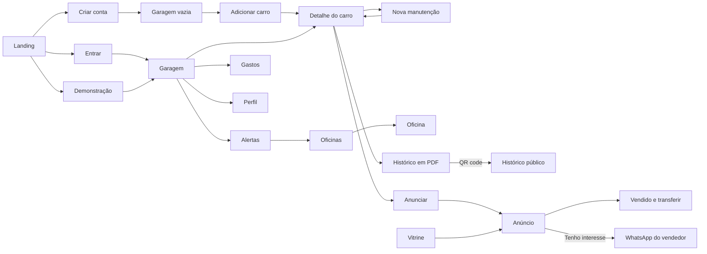

# Funcionalidades

Este documento descreve cada tela do app e as regras que o código aplica de verdade.
As telas ficam em `04_LANDING/app/`. As regras comuns (alertas, nota de saúde, formatação) ficam em
`04_LANDING/app/js/app.js`, e as da vitrine em `04_LANDING/app/js/vitrine.js`.

> Os endereços funcionam com e sem `.html` quando o site é servido (GitHub Pages ou a API).
> Aqui usamos o nome do arquivo.

## Sumário

- [Mapa das telas](#mapa-das-telas)
- [Regras principais](#regras-principais)
  - [Alertas](#alertas)
  - [Nota de saúde](#nota-de-saúde)
  - [Linha do tempo](#linha-do-tempo)
  - [Gastos e custo por km](#gastos-e-custo-por-km)
  - [Vitrine e FIPE](#vitrine-e-fipe)
  - [Transferência do prontuário](#transferência-do-prontuário)
  - [Avaliações de oficinas](#avaliações-de-oficinas)
- [Telas, uma por uma](#telas-uma-por-uma)

## Mapa das telas

| Arquivo | Tela | Menu | Precisa de login (modo API) |
|---|---|---|---|
| `../index.html` | Landing page | — | não |
| `entrar.html` | Login | — | não |
| `criar-conta.html` | Criar conta | — | não |
| `esqueci-senha.html` | Esqueci a senha | — | não |
| `demo.html` | Porta da demonstração | — | não |
| `garagem.html` | Minha garagem (e garagem vazia) | Garagem | sim |
| `adicionar-carro.html` | Adicionar carro | Garagem | sim |
| `carro.html` | Detalhe do carro (prontuário) | Garagem | sim |
| `nova-manutencao.html` | Nova manutenção | Garagem | sim |
| `alertas.html` | Alertas | Alertas | sim |
| `historico-pdf.html` | Histórico em PDF | Garagem | sim |
| `h.html` | Histórico público (QR code) | — | não |
| `vitrine.html` | Vitrine (e "Meus anúncios") | Vitrine | sim |
| `anuncio.html` | Anúncio | Vitrine | sim |
| `anunciar.html` | Anunciar carro | Vitrine | sim |
| `vendido.html` | Vendido e transferir prontuário | Garagem | sim |
| `oficinas.html` | Oficinas próximas (mapa e lista) | Oficinas | sim |
| `oficina.html` | Perfil da oficina e avaliações | Oficinas | sim |
| `gastos.html` | Painel de gastos | Gastos | sim |
| `perfil.html` | Perfil e configurações | (avatar) | sim |
| `termos.html` | Termos e privacidade | — | não |
| `../404.html` | Página não encontrada | — | não |

O menu tem cinco itens: **Garagem, Alertas, Vitrine, Oficinas e Gastos**. No computador ele fica na lateral; no
celular, numa barra embaixo. O item Alertas mostra uma bolinha com o número de alertas vencidos ou próximos que
ainda não foram marcados como lidos.

## Regras principais

### Alertas

Cada carro gera **cinco alertas** (função `alertasCarro` em `app.js`). Cada alerta tem um status:
**vencido**, **próximo**, **em dia** ou **pago**. A lista é ordenada por status (vencido primeiro) e, dentro do
status, pelo número de dias que faltam.

O prazo por km é calculado com a média de km por mês do carro: `dias até o alvo = km que falta ÷ (kmMes ÷ 30)`.
Quando existe prazo por data e por km, vale **o que vier primeiro**.

| Alerta | Regra | Próximo quando | Vencido quando |
|---|---|---|---|
| **Revisão** | A cada **10.000 km ou 12 meses** desde a última manutenção do tipo `revisao`. Sem revisão registrada, o alvo é o próximo múltiplo de 10.000 km. | faltam até 45 dias ou até 1.500 km | passou do km ou da data |
| **Troca de óleo** | A cada **10.000 km ou 12 meses** desde a última manutenção do tipo `oleo` **ou** `revisao` | faltam até 45 dias ou até 1.500 km | passou do km ou da data |
| **Licenciamento** (ano atual) | Vence no **último dia do mês** que depende do final da placa (tabela abaixo) | faltam até 60 dias | passou da data |
| **IPVA** (ano seguinte) | Cota única em **janeiro do ano seguinte, no dia 10 + final da placa** | faltam até 90 dias | passou da data |
| **Troca de pneus** | A cada **40.000 km ou 60 meses**, contando só manutenções do tipo `pneus` cuja descrição tenha "troca" ou "pneus novos" | faltam até 3.000 km | passou do km |

O **final da placa** é o último dígito da placa (`finalPlaca`).

| Final da placa | 1 | 2 | 3 | 4 | 5 | 6 | 7 | 8 | 9 | 0 |
|---|---|---|---|---|---|---|---|---|---|---|
| Licenciamento vence em | abr | mai | jun | jul | ago | set | out | nov | dez | dez |
| IPVA (cota única, janeiro) | dia 11 | dia 12 | dia 13 | dia 14 | dia 15 | dia 16 | dia 17 | dia 18 | dia 19 | dia 10 |

> Essas datas são **simplificadas** (inspiradas no calendário do Detran-PR, que muda a cada ano). A tela de alertas
> e os termos avisam para conferir sempre o calendário oficial.

O que dá para fazer na tela de Alertas:

- **Marcar como pago** (IPVA e licenciamento): pede o valor pago e registra um **pagamento**. O alerta passa
  para "pago" e o pagamento entra na linha do tempo do carro.
- **Marcar como lido** (alertas vencidos ou próximos): o alerta sai da contagem do menu, mas continua na lista.
  Dá para desmarcar.
- Atalhos: "Achar oficina" (revisão) e "Registrar troca" (óleo e pneus), que abre a nova manutenção já com o tipo.

### Nota de saúde

A nota vai de **20 a 100** e aparece num velocímetro (função `nota` em `app.js`).

| Passo | Pontos |
|---|---|
| Começa em | **85** |
| Manutenções com nota fiscal | **+1 cada**, até +6 |
| Manutenções registradas (com ou sem nota) | **+1 cada**, até +5 |
| Revisão vencida | **−18** |
| Troca de óleo vencida | **−8** |
| Outro alerta vencido (licenciamento, IPVA, pneus) | **−6 cada** |
| Revisão ou óleo "próximo" | **−4** (uma vez só) |
| Nenhuma manutenção, ou a última tem mais de 365 dias | **−15** |
| Resultado | limitado entre 20 e 100 |

| Nota | Texto | Cor do velocímetro |
|---|---|---|
| 90 ou mais | "Excelente. Revisões em dia." | verde |
| 80 a 89 | "Bom estado, com algo chegando." | verde |
| 60 a 79 | "Atenção: tem pendência." | âmbar |
| abaixo de 60 | "Precisa de cuidados." | vermelho |

A nota é recalculada sempre que algo muda: nova manutenção, km atualizado, imposto pago.
Na vitrine, a nota dos anúncios de outras pessoas é calculada com a mesma regra, a partir do histórico que veio da API.

### Linha do tempo

Fica no detalhe do carro (`carro.html`) e junta **manutenções** e **pagamentos de IPVA e licenciamento**,
agrupados por ano.

- **Filtros:** Todos, Revisão, Óleo, Freios, Pneus, Outros (suspensão, elétrica e outro) e Impostos.
- **Ordem:** mais recentes primeiro ou mais antigos primeiro (botão que inverte).
- **Legenda:** serviço com nota fiscal (comprovado, em verde), sem nota fiscal, e IPVA/licenciamento.
- Cada manutenção mostra serviço, valor, data, km, oficina e peças.
- Se a manutenção foi numa oficina cadastrada e a pessoa ainda não avaliou essa oficina, aparece o link
  **"Avaliar <oficina>"**.

Tipos de manutenção aceitos: `revisao`, `oleo`, `freios`, `pneus`, `suspensao`, `eletrica`, `outro`.

### Gastos e custo por km

**Na garagem** aparecem três números (só manutenções):

| Cartão | Cálculo |
|---|---|
| Gasto no mês | soma das manutenções do mês atual |
| Últimos 12 meses | soma das manutenções dos últimos 12 meses |
| Custo por km | gasto dos 12 meses ÷ (soma do km por mês de todos os carros × 12) |

**No painel de gastos** (`gastos.html`):

- Filtros: carro (todos ou um), período (**6 meses, 12 meses ou Tudo**) e a chave **"Incluir IPVA e licenciamento"**.
- Cartões: total no período, média por mês, **custo por km** e maior gasto.
- **Custo por km** = total do período ÷ (km por mês dos carros filtrados × número de meses).
  Para o motorista de app, esse cartão fica em destaque.
- Gráficos: barras por mês (o mês atual em verde), gastos por categoria (com %) e os 5 maiores gastos.

### Vitrine e FIPE

A vitrine junta três fontes (`vitrine.js`):

1. os **anúncios de exemplo** (`dados.js`, 7 carros);
2. no modo API, os **anúncios ativos de outras pessoas** (que vêm de `/api/estado`, campo `anunciosComunidade`);
3. os **anúncios da própria pessoa** que não estão vendidos nem pausados.

**Filtros** (podem ser combinados): até R$ 60 mil, até R$ 150 mil, Hatch, Sedã, SUV, Esportivo, Clássico,
Nota 80+, Abaixo da FIPE e Favoritos. Filtros do mesmo grupo (preço, categoria) somam; grupos diferentes se
combinam. Há também busca por texto (marca, modelo, versão, cidade) e **ordem**: mais recentes, menor preço,
maior nota de saúde ou menor km.

**Categoria** do carro da pessoa: descoberta pelo nome (marca, modelo e versão). Modelos como CR-V, RAV4, Q5,
Compass, Creta, T-Cross, Tracker, HR-V, Kicks e outros viram SUV; Corolla, Civic, Camry, Virtus, Cruze, Jetta,
City e outros viram sedã; o resto vira hatch.

**FIPE** (valor de exemplo):

- Tabela fixa para dois modelos: Polo 2019 = R$ 72.400 e CR-V 2017 = R$ 104.900.
- Para os outros: `110.000 × 0,9^idade`, arredondado para centenas (idade = ano atual − ano do carro).
- A comparação mostra "X% abaixo da FIPE", "X% acima da FIPE" ou "na média da FIPE". Ao anunciar, se o preço
  passar 10% acima, o app avisa que "acima de 10% costuma vender mais devagar".

**Anunciar** (`anunciar.html`):

- Escolhe o carro da garagem. A foto do carro é a principal; dá para pôr **até 3 fotos extras**.
- O preço é obrigatório e é comparado com a FIPE na hora.
- A descrição já vem sugerida com o número de manutenções e quantas têm nota fiscal.
- Chave **"Mostrar valores das manutenções"**: se desligada, o comprador vê os serviços e as datas, mas não quanto
  foi pago.
- Cada carro tem **um anúncio ativo**: publicar de novo troca o anúncio atual.

**Anúncio** (`anuncio.html`):

- Galeria de fotos, nota de saúde, selo "Histórico VEXOcar", ficha (versão, ano, km, categoria, cidade, data),
  preço, FIPE e a linha do tempo do histórico.
- **Quem está comprando:** botão **"Tenho interesse (WhatsApp)"**, que abre uma conversa com o vendedor,
  favoritar e compartilhar (compartilhamento do celular ou cópia do link). Em anúncios de outras pessoas, a visita
  é contada uma vez por sessão.
- **Quem é o dono:** vê o status (ativo, pausado ou vendido) e o número de visitas, pode **pausar** (sai da
  vitrine) ou **marcar como vendido**.

### Transferência do prontuário

Na tela `vendido.html` o dono informa **para quem vendeu**: e-mail ou celular com DDD (pelo menos 10 dígitos).
Depois de confirmar ("Não dá para desfazer"), acontece o seguinte:

**Modo API** (`05_API/src/vitrine.js`, rota `POST /api/carros/:id/transferir`):

1. O servidor confere se o carro é de quem pediu e se o contato não é o da própria pessoa.
2. Fica com o vendedor uma **"lembrança"** do carro na coleção `transferidos` (aparece como vendido nos anúncios dele).
3. Se o comprador **já tem conta** (achado pelo e-mail ou pelo final do WhatsApp do perfil), o carro, as
   manutenções e os pagamentos passam para ele na hora. Resposta: `transferido`.
4. Se o comprador **ainda não tem conta**, a transferência fica **esperando** (coleção `transferencias`).
   Quando a pessoa entrar com aquele e-mail, ou cadastrar aquele WhatsApp no perfil, o carro é entregue na
   próxima vez que o app carregar. Resposta: `esperando`.
5. O anúncio é marcado como vendido.

**Modo demonstração:** tudo acontece no navegador. O carro sai da garagem e vai para `transferidos`.

Também existe **"Só marcar como vendido"**: o anúncio sai da vitrine e o carro continua na garagem.

### Avaliações de oficinas

Na tela da oficina (`oficina.html`):

- A pessoa dá uma nota de **1 a 5 estrelas** (obrigatória), escolhe o serviço que fez (opcional) e escreve um
  comentário de até **280 caracteres** (opcional). As estrelas também funcionam com as setas do teclado.
- **Uma avaliação por pessoa por oficina.** Dá para editar ou apagar a própria avaliação.
- **Média mostrada** = (nota base da oficina × número de avaliações antigas + soma das avaliações feitas no app)
  ÷ total de avaliações. A nota base e o número de avaliações antigas vêm do cadastro de exemplo da oficina.
- O gráfico de distribuição (5 a 1 estrela) estima as avaliações antigas a partir da média e soma as do app.
- No modo API, o nome do autor é preenchido pelo servidor com o nome do perfil.

## Telas, uma por uma

### Landing page (`index.html`)

Página de entrada, em estilo cinematográfico: foto em tela cheia, paralaxe leve, seções que aparecem ao rolar.
Seções: por que usar, como funciona (3 passos), vitrine (caminhos "Quer vender?" e "Quer comprar?"), dado da
pesquisa e equipe. Botões: **Começar grátis**, **Ver demonstração**, **Entrar** e **Instalar app**.
Quem volta da demonstração pela landing sai do modo demonstração.

### Login (`entrar.html`)

E-mail e senha ou **Entrar com Google**. Link para "Esqueci a senha", "Criar conta" e, no modo API,
**"Ver demonstração sem criar conta"**. O parâmetro `?ir=` leva a pessoa, depois do login, para a tela pedida
(só aceita nomes de telas do próprio app).

### Criar conta (`criar-conta.html`)

Nome, e-mail, senha (mínimo de 8 caracteres, com indicador de força) e o perfil: **Motorista de app** ou
**Dono(a) de carro**. É preciso aceitar os termos. Também dá para criar com Google. A conta nova começa com a
garagem vazia; a vitrine e as oficinas de exemplo continuam aparecendo.

### Esqueci a senha (`esqueci-senha.html`)

Pede o e-mail. Com o Firebase ligado, o próprio Firebase manda o link de troca de senha. A tela não revela se o
e-mail tem conta ou não. No modo local da API, nenhum e-mail é enviado.

### Demonstração (`demo.html`)

Liga o modo demonstração neste navegador, recomeça a conta de exemplo (3 carros: Polo, CR-V e Camry, com
histórico e alertas) e abre a garagem. Nada vai para o banco. Veja os modos em [ARQUITETURA.md](ARQUITETURA.md#os-modos).

### Minha garagem (`garagem.html`)

Saudação pelo horário, três cartões de gastos (mês, 12 meses, custo por km), o **alerta mais urgente não lido** e
os carros (foto, modelo, placa, km, número de manutenções e velocímetro da nota). Sem carros, mostra a
**garagem vazia** com um único caminho: "Adicionar meu primeiro carro".

### Adicionar carro (`adicionar-carro.html`)

Foto (opcional; sem foto, entra um desenho neutro), placa, ano, marca, modelo, versão, km atual e km por mês.

| Campo | Regra |
|---|---|
| Placa | formato antigo ou Mercosul: `ABC1234` ou `ABC1D23` (o hífen é aceito na digitação) |
| Ano | 1950 a 2027 na tela (a API aceita até o ano atual + 1) |
| Marca e modelo | obrigatórios |
| Km por mês | maior que zero (é ele que prevê a próxima revisão) |
| Placa repetida | não deixa cadastrar a mesma placa duas vezes na garagem |

### Detalhe do carro (`carro.html`)

O prontuário: foto, nota de saúde, placa, km, números (manutenções, quantas com nota fiscal, total gasto),
alertas vencidos e próximos, e a [linha do tempo](#linha-do-tempo). Botões: **Manutenção**, **Histórico PDF** e
**Anunciar na vitrine** (ou "Ver meu anúncio", se já houver). Tem um campo para **atualizar o km**: o km novo
precisa ser maior que o atual, e os alertas e a nota são recalculados.

### Nova manutenção (`nova-manutencao.html`)

Escolhe o carro e o tipo de serviço (chips). Campos: data (até hoje), km no dia, descrição (sugerida pelo tipo),
peças, valor (obrigatório, maior que zero), oficina (com sugestões das oficinas cadastradas) e a **foto da nota
fiscal**. Com a foto, o serviço entra como **comprovado**. Se o km informado for maior que o do carro, o km do
carro é atualizado.

### Alertas (`alertas.html`)

Filtro por carro e três grupos: **Vencidos**, **Próximos** e **Em dia** (este fechado, para abrir). Regras em
[Alertas](#alertas).

### Histórico em PDF (`historico-pdf.html`)

Monta um documento claro, pronto para imprimir ou salvar em PDF (botão usa a impressão do navegador): dados do
carro, nota de saúde, número de manutenções e quantas têm nota fiscal, e a tabela da linha do tempo.
Chaves para mostrar ou esconder: **valores pagos**, **fotos das notas** (indicação no texto) e **oficinas**.
No rodapé, um **QR code** leva para a página pública do histórico. Também dá para mandar o link pelo WhatsApp.

### Histórico público (`h.html`)

O que o comprador vê ao ler o QR code, **sem precisar de conta**: carro, nota de saúde, número de manutenções,
quantas têm nota fiscal, se as revisões estão em dia e a linha do tempo. No modo API, os dados vêm da rota pública,
que entrega **sem valores em R$, com a placa mascarada e sem a foto da nota fiscal** (ex.: `BRA2E19` vira
`BRA***9`). Termina com o convite "Também tem carro? Criar minha conta".

### Vitrine (`vitrine.html`)

Grade de anúncios com foto, nota, preço e diferença para a FIPE. Filtros, busca e ordem em
[Vitrine e FIPE](#vitrine-e-fipe). Com `?meus=1`, vira **Meus anúncios** (com status e "Marcar vendido");
com `?fav=1`, abre já filtrada nos favoritos.

### Anúncio (`anuncio.html`), Anunciar (`anunciar.html`) e Vendido (`vendido.html`)

Veja [Vitrine e FIPE](#vitrine-e-fipe) e [Transferência do prontuário](#transferência-do-prontuário).

### Oficinas próximas (`oficinas.html`)

Mapa (Leaflet com o mapa escuro da Esri) e lista ordenada pela **distância**. A distância é calculada em linha reta
a partir do Centro de Curitiba ou, com **"Perto de mim"**, da localização do aparelho. Filtros **Todas** e
**Abertas agora** e busca sem acento por nome, especialidade ou serviço. "Aberta agora" = de segunda a sábado,
das 8h até o horário de fechar da oficina. Sem internet, o mapa some e a lista continua.

### Oficina (`oficina.html`)

Foto, especialidade, distância, endereço, horário (com "aberta agora · fecha às..."), serviços, **Chamar no
WhatsApp** e **Como chegar** (rota no OpenStreetMap), mini mapa, quantos serviços a pessoa já fez ali e as
[avaliações](#avaliações-de-oficinas).

### Painel de gastos (`gastos.html`)

Veja [Gastos e custo por km](#gastos-e-custo-por-km).

### Perfil (`perfil.html`)

Nome, e-mail, desde quando usa e quantos carros tem. Troca do perfil (motorista ou dono), preferências de
notificação (revisão e óleo; IPVA e licenciamento; interessados nos anúncios), favoritos, meus anúncios, termos,
**Instalar o app**, **Meus dados** (nome, e-mail e WhatsApp com DDD, usado no "Tenho interesse" dos anúncios),
**Restaurar dados de exemplo** e **Sair**.

### Termos e privacidade (`termos.html`)

Termos de uso e política de privacidade (LGPD): o que é guardado, para que, onde fica, o que fica público e os
direitos de quem usa.

### App instalável (PWA)

O botão **Instalar app** aparece na landing e no Perfil (só quando o site é aberto por um servidor e o app ainda
não está instalado). Se o navegador oferece a instalação (Chrome, Edge), abre a dele; senão, mostra o passo a
passo do aparelho (iPhone, Android ou computador). O app instalado abre na garagem e tem atalhos para
"Nova manutenção" e "Alertas" (`manifest.webmanifest`).
