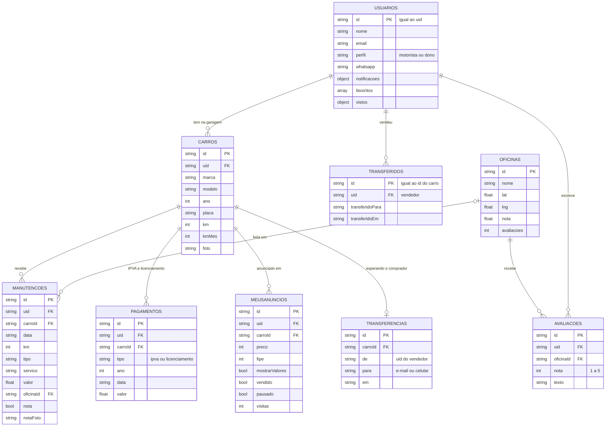

# Modelo de dados

O mesmo formato de dados vale para o navegador (modo demonstração) e para o banco (modo API).
Os exemplos estão em `04_LANDING/app/js/dados.js`; as regras de validação, em `05_API/src/rotas/colecoes.js`.

- No **Firestore**, cada coleção abaixo é uma coleção do Firestore, e o id do documento é o campo `id`.
- No **modo local**, tudo fica em `05_API/dados-locais.json`, no formato `{ coleção: { id: documento } }`.
- No **navegador**, tudo fica num objeto só (chave `vexocar:v1` do `localStorage` na demonstração; cache da API no
  modo API).

Todo documento que é de uma pessoa leva o campo **`uid`** (o id da conta) e **`atualizadoEm`** (data e hora da
última gravação). A API grava esses dois campos e os tira antes de mandar para o app.

## Diagrama

## Coleções

### `usuarios` (no app: `usuario` + campos do perfil)

Criado pela API no primeiro acesso. No app, os dados pessoais ficam em `d.usuario`, e `notificacoes`, `favoritos`
e `vistos` ficam na raiz do objeto.

| Campo | Tipo | O que é |
|---|---|---|
| `id`, `uid` | texto | id da conta (Firebase Auth ou `u` + código no modo local) |
| `nome` | texto | nome (pelo menos 2 letras) |
| `email` | texto | e-mail |
| `perfil` | texto | `motorista` ou `dono` |
| `cidade` | texto | começa como "Curitiba, PR" |
| `desde` | texto | mês de entrada, `AAAA-MM` |
| `whatsapp` | texto | só dígitos, com DDI (o app põe `55` quando falta), de 10 a 13 dígitos |
| `notificacoes` | objeto | `{ revisao, documentos, interessados }`, cada um `true`/`false` |
| `favoritos` | lista | ids de anúncios favoritados |
| `vistos` | objeto | ids de alertas marcados como lidos (`{ "c1:rev90000": true }`) |

### `carros`

| Campo | Tipo | O que é |
|---|---|---|
| `id` | texto | gerado no app (`c` + código) |
| `marca`, `modelo`, `versao` | texto | `versao` é opcional |
| `ano` | número | 1950 até o ano atual + 1 |
| `placa` | texto | `ABC1234` ou `ABC1D23`, maiúsculas, sem hífen |
| `km` | número | km atual |
| `kmMes` | número | média de km por mês (prevê revisão e custo por km) |
| `foto` | texto | endereço da foto (ou um desenho SVG pequeno de "sem foto") |
| `cor` | texto | opcional |

### `manutencoes`

| Campo | Tipo | O que é |
|---|---|---|
| `id` | texto | `m` + código |
| `carroId` | texto | carro da garagem |
| `data` | texto | `AAAA-MM-DD` |
| `km` | número | km no dia do serviço |
| `tipo` | texto | `revisao`, `oleo`, `freios`, `pneus`, `suspensao`, `eletrica` ou `outro` |
| `servico` | texto | descrição |
| `pecas` | texto | peças trocadas (opcional) |
| `valor` | número | em reais |
| `oficina` | texto | nome digitado |
| `oficinaId` | texto ou `null` | id da oficina, quando o nome bate com uma cadastrada |
| `nota` | booleano | `true` = tem nota fiscal anexada (serviço **comprovado**) |
| `notaFoto` | texto | endereço da foto da nota fiscal (pasta `notas`) |

### `pagamentos`

IPVA e licenciamento pagos. Entram na linha do tempo e tiram o alerta.

| Campo | Tipo | O que é |
|---|---|---|
| `id` | texto | `d` + código |
| `carroId` | texto | carro |
| `tipo` | texto | `ipva` ou `licenciamento` |
| `ano` | número | ano do imposto |
| `data` | texto | data do pagamento |
| `valor` | número | valor pago |

### `meusAnuncios`

Anúncios criados pela pessoa.

| Campo | Tipo | O que é |
|---|---|---|
| `id` | texto | `u` + código |
| `carroId` | texto | carro anunciado |
| `preco` | número | preço pedido |
| `fipe` | número | valor FIPE de exemplo na hora de anunciar |
| `descricao` | texto | texto do anúncio |
| `mostrarValores` | booleano | mostra ou esconde os valores das manutenções para o comprador |
| `fotos` | lista | foto do carro + até 3 extras (pasta `anuncios`) |
| `publicado` | texto | data |
| `visitas` | número | contado pelo servidor |
| `vendido`, `pausado` | booleano | status |
| `vendidoEm`, `transferidoPara` | texto | preenchidos na venda |
| `carro` | objeto | cópia do carro guardada na venda (o anúncio continua mostrando o carro) |

### `transferidos`

A "lembrança" do carro que a pessoa vendeu. O id é o mesmo do carro. Tem os campos do carro mais
`transferidoPara` (contato do comprador) e `transferidoEm` (data). O `uid` é o do **vendedor**.

### `transferencias` (só na API)

Transferências esperando o comprador criar conta.

| Campo | O que é |
|---|---|
| `id` | `t` + código |
| `carroId` | carro |
| `de` | uid do vendedor |
| `para` | e-mail (minúsculas) ou só os dígitos do celular |
| `em` | data |

Enquanto espera, o carro e o histórico ficam com o `uid` `espera:<id da transferência>`, ou seja, de ninguém.

### `oficinas` (de exemplo, todo mundo lê)

| Campo | O que é |
|---|---|
| `id`, `nome`, `especialidade`, `endereco` | dados da oficina |
| `lat`, `lng` | posição no mapa |
| `nota`, `avaliacoes` | média e número das avaliações antigas (base da média) |
| `horario` | texto do horário |
| `fecha` | hora de fechar (ex.: `17.5` = 17h30); usada no "aberta agora" |
| `whatsapp` | `demo` = usa o contato de demonstração |
| `servicos` | lista de serviços |
| `foto` | foto |

### `avaliacoes`

| Campo | O que é |
|---|---|
| `id` | `v` + código |
| `oficinaId` | oficina avaliada |
| `autor` | nome mostrado (no modo API, o servidor usa o nome do perfil) |
| `nota` | 1 a 5 |
| `servico` | tipo de serviço (opcional) |
| `texto` | comentário, até 280 caracteres (opcional) |
| `data` | data |
| `minha` | calculado ao mandar para o app: `true` se é da pessoa. Não é gravado. |

As avaliações de exemplo ficam no banco com `uid: null`.

### `anuncios` (de exemplo, todo mundo lê)

Anúncios prontos da vitrine. Campos: `id`, `marca`, `modelo`, `versao`, `ano`, `km`, `preco`, `fipe`, `cidade`,
`categoria` (`hatch`, `seda`, `suv`, `esportivo`, `classico`), `foto`, `nota`, `manutencoes`, `comprovadas`,
`publicado`, `visitas`, `vendedor` (`nome`, `desde`, `whatsapp`), `descricao` e `historico`
(lista de `data`, `km`, `servico`, `nota`, `oficina`).

### Coleções internas da API

| Coleção | Para quê |
|---|---|
| `contasLocais` | Só no modo local: contas com `id` (= e-mail), `uid`, `email`, `nome`, `sal` e `hash` da senha |
| `sistema` | Documento `exemplo` com a `versao` dos dados de exemplo já gravados no banco |

## Campos só do navegador

| Campo | O que é |
|---|---|
| `versao` | versão dos dados de exemplo; subir quando o exemplo mudar (o navegador recarrega e a API grava de novo) |
| `hoje` | data fixa da demonstração (`2026-11-03`); no modo API vira a data real |
| `contatoDemo` | WhatsApp usado pelos contatos de exemplo; vazio no repositório |
| `logado` | se a pessoa entrou (modo demonstração) |
| `anunciosComunidade` | anúncios de outras pessoas, vindos de `/api/estado` |

## Prefixos de id

| Prefixo | Coleção |
|---|---|
| `c` | carros |
| `m` | manutenções |
| `d` | pagamentos |
| `u` | meus anúncios |
| `v` | avaliações |
| `t` | transferências (criado pela API) |

Os ids gerados no app são o prefixo + a hora em base 36 + 3 caracteres aleatórios.
