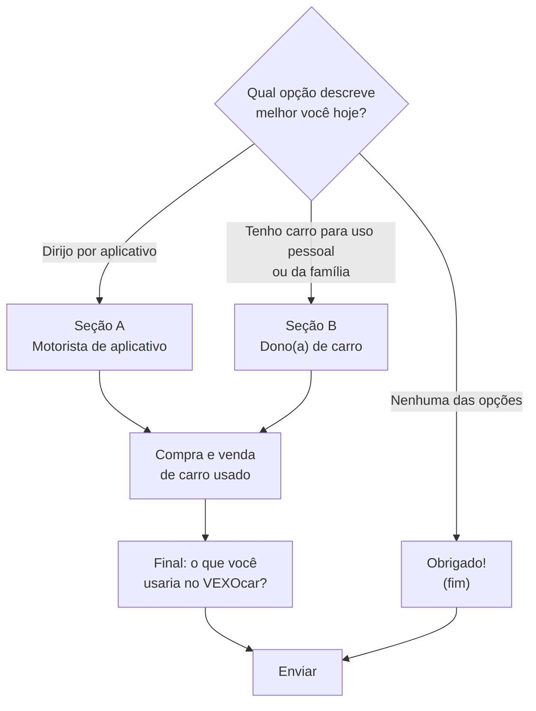

# Pesquisa com o público

## Como funciona

A pesquisa de campo é um **Google Forms** montado por script: `01_PESQUISA/criar_forms.gs` (Google Apps Script).
O script refaz o formulário já publicado mantendo o mesmo link, cria uma planilha nova de respostas e mostra no
registro de execução a ordem final das perguntas.

| Item | Como está |
|---|---|
| Público | **motoristas de aplicativo** e **donos(as) de carro** |
| Tempo | cerca de 4 minutos |
| Anonimato | anônima; o formulário não coleta e-mail |
| Outros ajustes | barra de progresso ligada; não dá para editar a resposta depois de enviar |
| Divulgação | por WhatsApp (textos prontos em `01_PESQUISA/mensagem_whatsapp.md`) |
| Prazo | aberta até **13/11/2026** |

### Ramificação

A primeira pergunta separa os perfis. Cada perfil responde a sua seção e depois as partes comuns.
Quem marca **"Nenhuma das opções"** vai direto para uma página de agradecimento e a pesquisa termina.

Quem dirige por aplicativo e também usa o carro no dia a dia é orientado a escolher "Dirijo por aplicativo".

## Perguntas

Todas são obrigatórias, menos as marcadas como **(opcional)**. "Várias" = pode marcar mais de uma opção.
"+ Outro" = tem campo para outra resposta.

### Abertura

| # | Pergunta | Tipo | Opções |
|---|---|---|---|
| 1 | Qual opção descreve melhor você hoje? | escolha única | Dirijo por aplicativo (Uber, 99, inDrive...) · Tenho carro para uso pessoal ou da família · Nenhuma das opções |

### Seção A: motorista de aplicativo

| # | Pergunta | Tipo | Opções |
|---|---|---|---|
| A1 | Há quanto tempo você dirige por aplicativo? | escolha única | Menos de 6 meses · De 6 meses a 1 ano · De 1 a 3 anos · Mais de 3 anos |
| A2 | O carro que você usa para rodar no aplicativo é: | escolha única | Meu, já quitado · Meu, ainda financiado · Alugado (de locadora ou de outra pessoa) · Emprestado de familiar ou amigo |
| A3 | Em que ano o seu carro foi fabricado? | escolha única | 2022 ou mais novo · Entre 2018 e 2021 · Entre 2013 e 2017 · 2012 ou mais antigo · Não sei |
| A4 | Em uma semana normal, quantos quilômetros você roda com esse carro? | escolha única | Até 500 km · De 500 a 1.000 km · De 1.000 a 2.000 km · Mais de 2.000 km · Não sei |
| A5 | Hoje, como você sabe quando está na hora de fazer a manutenção do carro (troca de óleo, revisão, pneus)? | várias + Outro | Não acompanho, só levo quando dá problema · Guardo de cabeça · Anoto em caderno ou papel · Uso uma planilha · Uso um aplicativo · Pelo adesivo de troca de óleo no para-brisa · A oficina ou a concessionária me avisa |
| A6 | Nos últimos 12 meses, você ficou algum dia sem trabalhar porque o carro quebrou ou precisou de um conserto que você não esperava? | escolha única | Sim, mais de uma vez · Sim, uma vez · Não |
| A7 | Em média, quanto você gasta por mês com a manutenção do carro? (sem combustível) | escolha única | Até R$ 200 · De R$ 200 a R$ 500 · De R$ 500 a R$ 1.000 · Mais de R$ 1.000 · Não sei |
| A8 | Nos últimos 2 anos, você esqueceu ou atrasou algum destes? | várias | Revisão ou troca de óleo · Pagamento do IPVA · Licenciamento · Renovação do seguro · Troca de pneus · Nenhum, nunca esqueci |
| A9 | Para você, quão difícil é encontrar uma oficina de confiança perto de onde você mora ou trabalha? | escala 1 a 5 | 1 = Muito fácil · 5 = Muito difícil |
| A10 | Qual é a sua maior dor de cabeça com a manutenção do carro? Se lembrar, conte uma situação. **(opcional)** | texto longo | — |

### Seção B: dono(a) de carro

| # | Pergunta | Tipo | Opções |
|---|---|---|---|
| B1 | Para que você mais usa o carro? | várias + Outro | Ir e voltar do trabalho ou da faculdade · Levar e buscar a família · Passeios, fins de semana e viagens · Trabalho (visitas a clientes, entregas) |
| B2 | Em que ano o seu carro foi fabricado? | escolha única | 2022 ou mais novo · Entre 2018 e 2021 · Entre 2013 e 2017 · 2012 ou mais antigo · Não sei |
| B3 | Em um mês normal, quantos quilômetros você roda com o carro? | escolha única | Até 500 km · De 500 a 1.000 km · De 1.000 a 2.000 km · Mais de 2.000 km · Não sei |
| B4 | Hoje, como você sabe quando está na hora de fazer a manutenção do carro (troca de óleo, revisão, pneus)? | várias + Outro | as mesmas opções da A5 |
| B5 | Sem consultar nenhum papel ou adesivo: você sabe quando foi a última troca de óleo do seu carro? | escolha única | Sim, sei a data ou a quilometragem · Sei mais ou menos (o mês aproximado) · Não sei |
| B6 | Você guarda as notas fiscais e os comprovantes dos serviços feitos no carro? | escolha única | Sim, guardo todos e sei onde estão · Guardo alguns, mas muitos se perdem · Não guardo |
| B7 | Nos últimos 2 anos, você esqueceu ou atrasou algum destes? | várias | as mesmas opções da A8 |
| B8 | Quando o carro precisa de manutenção ou conserto, como você escolhe a oficina? | várias + Outro | Indicação de amigos ou família · A que fica mais perto · A que cobra mais barato · Pelas avaliações no Google ou no Maps · Vou sempre na mesma · Levo na concessionária |
| B9 | Qual é a sua maior dor de cabeça com a manutenção do carro? Se lembrar, conte uma situação. **(opcional)** | texto longo | — |

Repare que a quilometragem é perguntada **por semana** para o motorista de app e **por mês** para o dono de carro.

### Compra e venda de carro usado (os dois perfis)

| # | Pergunta | Tipo | Opções |
|---|---|---|---|
| C1 | Você já comprou ou vendeu um carro usado? | escolha única | Já comprei · Já vendi · Já comprei e já vendi · Nunca |
| C2 | Na compra de um carro usado, quando o vendedor diz que "as revisões estão em dia", quanto você acredita nisso? | escala 1 a 5 | 1 = Não acredito · 5 = Acredito totalmente |
| C3 | Imagine dois carros iguais à venda, mas só um deles tem o histórico de manutenção comprovado (notas fiscais, datas e oficinas). O que você faria? | escolha única | Pagaria mais pelo carro com histórico · Pagaria o mesmo valor, mas escolheria o carro com histórico · Tanto faz, não faria diferença para mim |
| C4 | Onde você procuraria ou anunciaria um carro usado? | várias + Outro | OLX · Webmotors · iCarros · Marketplace do Facebook · Concessionária ou loja de carros · Com amigos e família |

### Final: o que você usaria no VEXOcar? (os dois perfis)

| # | Pergunta | Tipo | Opções |
|---|---|---|---|
| F1 | O VEXOcar pode ter as funções abaixo. Dê uma nota de 1 a 5 para o quanto você usaria cada uma. | grade 1 a 5 (1 = não usaria, 5 = usaria muito) | linhas na tabela abaixo |
| F2 | Você usaria um aplicativo como o VEXOcar? | escolha única | Sim, com certeza · Talvez · Não |
| F3 | Se o VEXOcar fosse pago, quanto você pagaria por mês? | escolha única | Nada, só usaria se fosse grátis · Até R$ 9,90 · De R$ 10 a R$ 20 · Mais de R$ 20 |
| F4 | Qual a sua idade? | escolha única | Até 24 anos · De 25 a 34 anos · De 35 a 44 anos · De 45 a 59 anos · 60 anos ou mais |
| F5 | Tem alguma função que você gostaria que o VEXOcar tivesse? **(opcional)** | texto longo | — |
| F6 | Topa uma conversa rápida de 5 minutos para contar mais? Se sim, deixe seu WhatsApp. **(opcional)** | texto curto | usado só para essa conversa da pesquisa acadêmica; não é divulgado |

Linhas da grade F1 e a parte do app que cada uma testa:

| Função perguntada | No app |
|---|---|
| Lembretes de revisão, troca de óleo, IPVA e licenciamento | Alertas |
| Histórico do carro com as fotos das notas fiscais dos serviços | Linha do tempo e nota fiscal |
| Mapa com oficinas próximas e avaliações de outros motoristas | Oficinas e avaliações |
| Anunciar o carro para venda com o histórico de manutenção junto | Vitrine |
| Consultar o valor do carro na tabela FIPE | Comparação com a FIPE |
| Painel mostrando quanto você gasta com o carro por mês e por quilômetro | Painel de gastos |

### Página "Obrigado!" (quem marcou "Nenhuma das opções")

Explica que a pesquisa é para motoristas de aplicativo e para quem tem carro, agradece e pede para compartilhar o
link com quem dirige. Depois, "Enviar".

## Resultados

A pesquisa está aberta até 13/11/2026. **Os resultados serão apresentados no relatório final** do Projeto
Integrador. A landing page mostra hoje um dado parcial, que será trocado pelo número final quando a pesquisa
fechar.
